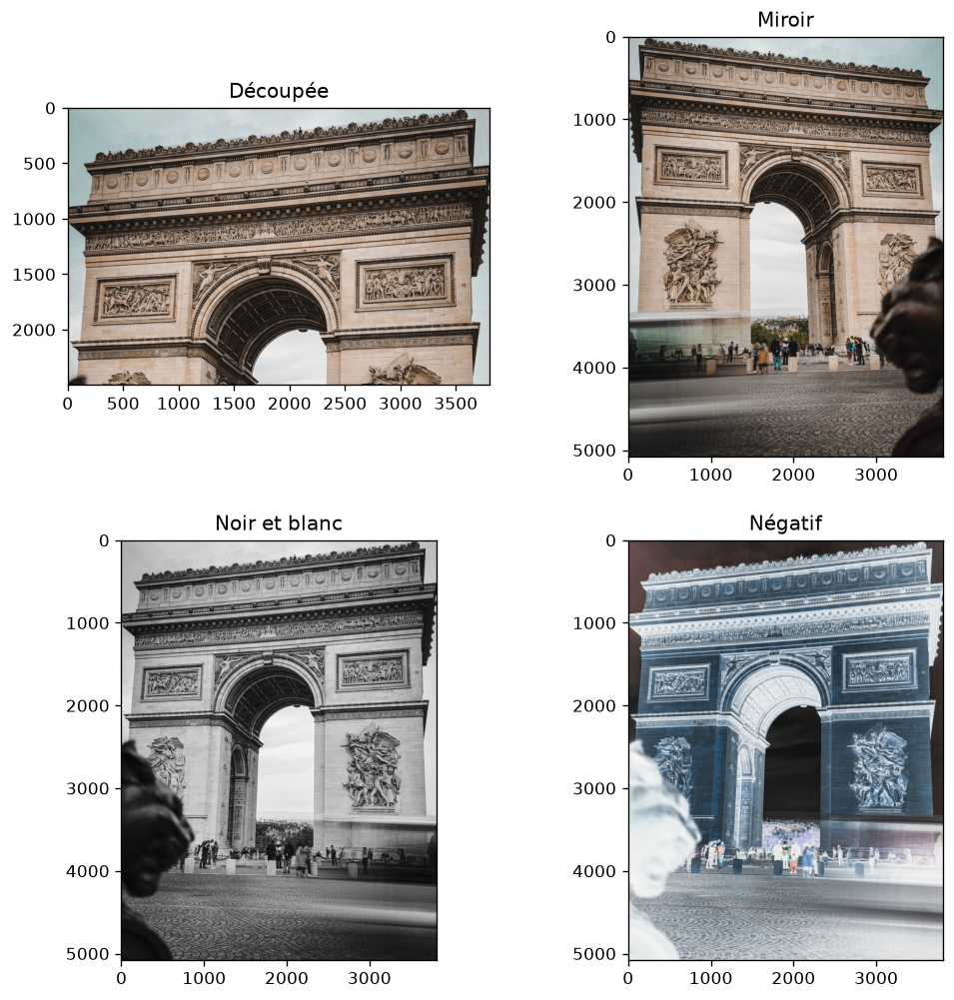
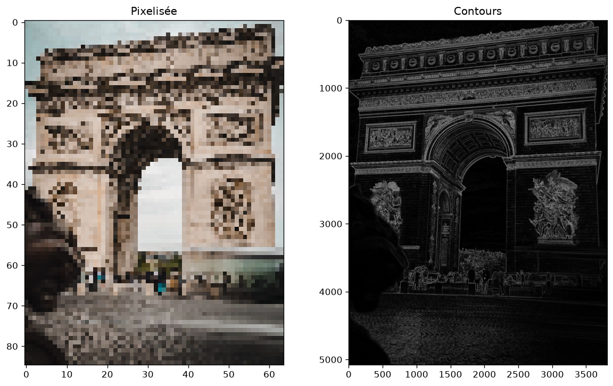
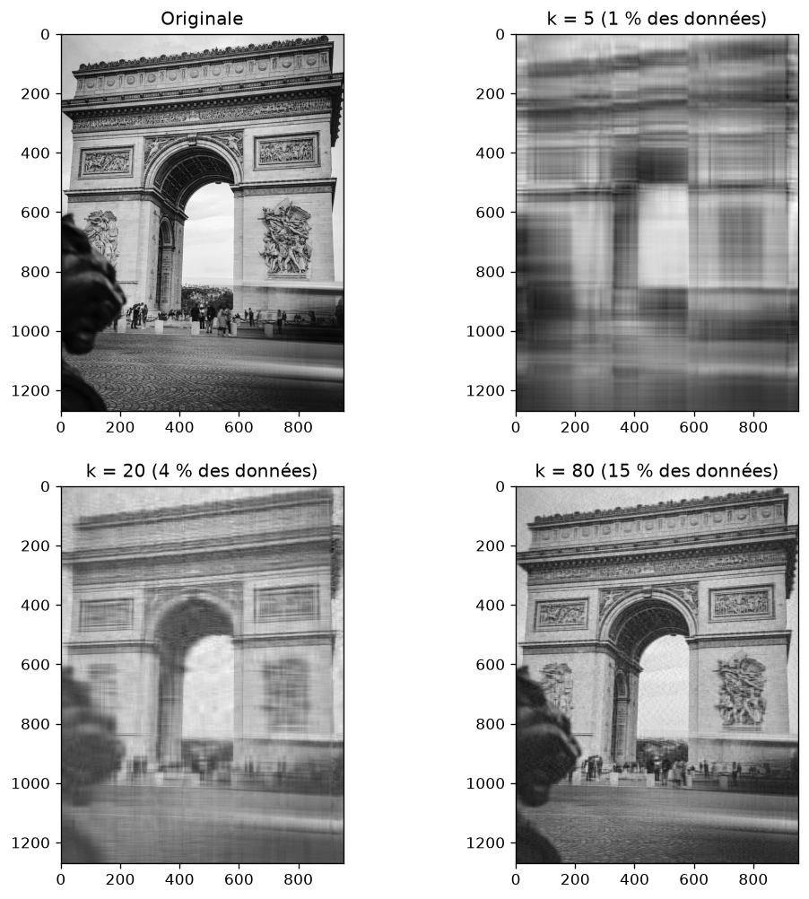

# Traitement d'image avec NumPy

Premier projet NumPy : manipuler une photo (un tableau de nombres) sans boucle, puis la compresser avec la SVD.

## Contenu

- etape1.py : bases de NumPy (tableaux, shape, découpage)
- etape2.py : ouvrir une image et regarder ses dimensions
- etape3.py : découpage, miroir, noir et blanc, négatif
- etape4.py : pixelisation et détection de contours
- etape5.py : compression d'image par décomposition en valeurs singulières (SVD)

## Résultats

Transformations :

Contours :

Compression SVD (k = nombre de valeurs singulières gardées) :

## Ce que j'ai appris

- Une image est un tableau NumPy (lignes, colonnes, couleurs).
- Le découpage permet de recadrer, retourner ou pixeliser sans boucle.
- La différence entre pixels voisins fait ressortir les contours.
- La SVD décompose l'image en couches classées par importance : en gardant seulement les k premières, on garde l'essentiel avec une fraction des données.

## Lancer le projet

pip install numpy matplotlib, puis mettre une photo nommée photo.jpg dans le dossier et lancer un des fichiers etape.